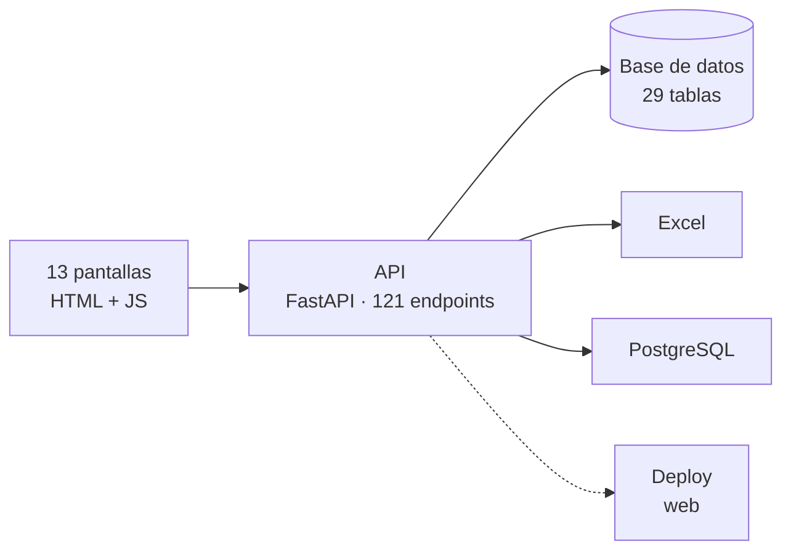

# Arquitectura · salon_ivana

Generado leyendo el repo. **No editar a mano**: lo regenera el CI en cada commit.

Todo lo que figura acá está escrito en el código. Nada está inferido por un modelo de lenguaje: si algo no se puede probar leyendo el repo, no aparece.

## Las piezas

## Qué datos toca cada pantalla

Las tablas principales de cada pantalla. El detalle completo está abajo.

```mermaid
graph LR
  Padminhtml["admin.html"]
  Tcomprobantes[("comprobantes")]
  Padminhtml --> Tcomprobantes
  Titems[("items")]
  Padminhtml --> Titems
  Tegresos[("egresos")]
  Padminhtml --> Tegresos
  Pagendahtml["agenda.html"]
  Templeados[("empleados")]
  Pagendahtml --> Templeados
  Texcepcionesh[("excepciones_horario")]
  Pagendahtml --> Texcepcionesh
  Tclientes[("clientes")]
  Pagendahtml --> Tclientes
  Pcajahtml["caja.html"]
  Pcajahtml --> Tegresos
  Pcajahtml --> Tcomprobantes
  Tfondocaja[("fondo_caja")]
  Pcajahtml --> Tfondocaja
  Pclienteshtml["clientes.html"]
  Pclienteshtml --> Tclientes
  Pclienteshtml --> Tcomprobantes
  Tpagos[("pagos")]
  Pclienteshtml --> Tpagos
  Pcuentahtml["cuenta.html"]
  Pcuentahtml --> Tclientes
  Pcuentahtml --> Tcomprobantes
  Pcuentahtml --> Titems
  Pdepilacionhtml["depilacion.html"]
  Pdepilacionhtml --> Tclientes
  Tsesionesdepi[("sesiones_depilacion")]
  Pdepilacionhtml --> Tsesionesdepi
  Pdepilacionhtml --> Titems
  Phistorialhtml["historial.html"]
  Phistorialhtml --> Tcomprobantes
  Phistorialhtml --> Tclientes
  Tcomprobantee[("comprobante_extras")]
  Phistorialhtml --> Tcomprobantee
  Pinventariohtml["inventario.html"]
  Pinventariohtml --> Titems
  Tmovimientoss[("movimientos_stock")]
  Pinventariohtml --> Tmovimientoss
  Pjsadminjs["js/admin.js"]
  Pjsadminjs --> Titems
  Tusuarios[("usuarios")]
  Pjsadminjs --> Tusuarios
  Pjsadminjs --> Templeados
  Pjsfacturarjs["js/facturar.js"]
  Pjsfacturarjs --> Tegresos
  Pjsfacturarjs --> Titems
  Pjsfacturarjs --> Tclientes
  Pjsgeneralesjs["js/generales.js"]
  Pjsgeneralesjs --> Templeados
  Tconfig[("config")]
  Pjsgeneralesjs --> Tconfig
  Taliastransfe[("alias_transferencia")]
  Pjsgeneralesjs --> Taliastransfe
  Pjslistasjs["js/listas.js"]
  Tajustesitem[("ajustes_item")]
  Pjslistasjs --> Tajustesitem
  Pjslistasjs --> Taliastransfe
  Tdescuentos[("descuentos")]
  Pjslistasjs --> Tdescuentos
  Pjspeluquerojs["js/peluquero.js"]
  Pjspeluquerojs --> Templeados
  Pjssenasjs["js/senas.js"]
  Pjssenasjs --> Tclientes
  Tsenas[("senas")]
  Pjssenasjs --> Tsenas
  Pjssenasjs --> Taliastransfe
  Pjssueldosjs["js/sueldos.js"]
  Pjssueldosjs --> Templeados
  Pjssueldosjs --> Titems
  Tliquidacione[("liquidaciones")]
  Pjssueldosjs --> Tliquidacione
  Ploginhtml["login.html"]
  Ploginhtml --> Tusuarios
  Preporteshtml["reportes.html"]
  Preporteshtml --> Tclientes
  Preporteshtml --> Tcomprobantes
  Preporteshtml --> Tpagos
  Ptickethtml["ticket.html"]
  Ptickethtml --> Tclientes
  Ptickethtml --> Tcomprobantes
  Ptickethtml --> Titems
```

## Librerías

De dónde sale: la versión, de `requirements*.txt`; el uso, de los `import` de cada archivo. Una librería declarada que nadie importa se nota.

| Librería | Versión | Quién la usa |
|---|---|---|
| `fastapi` | 0.115.6 | `main.py`, `tests/test_plata.py` |
| `openpyxl` | 3.1.5 | `main.py` |
| `psycopg2-binary` | 2.9.10 | sin import directo |
| `pydantic` | 2.10.4 | `main.py` |
| `pytest` | 8.3.4 | `tests/test_backup.py`, `tests/test_plata.py` |
| `sqlalchemy` | 2.0.36 | `cargar_depilacion.py`, `database.py`, `levantar_local.py`, `main.py` y 3 más |
| `uvicorn` | 0.34.0 | `levantar_local.py` |

<b>Desglose por pantalla</b> — endpoints y tablas, uno por uno

### admin.html

- Endpoints que usa: **14**
- Tablas que tocan esos endpoints: `comprobante_lineas`, `comprobantes`, `egresos`, `empleados`, `excepciones_horario`, `horarios_empleado`, `items`, `turnos`

| Método | Endpoint | Función | Tablas |
|---|---|---|---|
| POST | `/api/admin/recalcular-transfer` | `recalcular_transfer` | items |
| POST | `/api/agenda/abrir-dia` | `abrir_dia` | empleados, excepciones_horario |
| GET | `/api/agenda/dia` | `agenda_dia` | empleados, horarios_empleado, turnos |
| GET | `/api/caja/dia` | `caja_dia` | comprobantes, egresos |
| GET | `/api/caja/diario` | `caja_diario` | — |
| GET | `/api/caja/semanal` | `caja_semanal` | — |
| GET | `/api/inventario` | `inventario` | items |
| GET | `/api/reportes/deuda` | `rep_deuda` | comprobantes |
| GET | `/api/reportes/excel` | `reportes_excel` | — |
| GET | `/api/reportes/ranking-items` | `ranking_items` | comprobante_lineas, comprobantes, items |
| GET | `/api/reportes/resumen` | `rep_resumen` | comprobantes, egresos |
| GET | `/api/reportes/serie-caja` | `serie_caja` | egresos |
| GET | `/api/reportes/serie-categorias` | `serie_categorias` | comprobante_lineas, comprobantes, items |
| GET | `/api/reportes/serie-items` | `serie_items` | comprobante_lineas, comprobantes |

### agenda.html

- Endpoints que usa: **11**
- Tablas que tocan esos endpoints: `clientes`, `empleados`, `excepciones_horario`, `items`, `notas_diarias`, `turnos`

| Método | Endpoint | Función | Tablas |
|---|---|---|---|
| POST | `/api/agenda/abrir-dia` | `abrir_dia` | empleados, excepciones_horario |
| GET | `/api/catalogo` | `catalogo` | items |
| GET | `/api/clientes` | `listar_clientes` | clientes |
| POST | `/api/clientes` | `crear_cliente` | clientes |
| GET | `/api/empleados` | `listar_empleados` | empleados |
| POST | `/api/empleados` | `crear_empleado` | empleados |
| POST | `/api/excepciones` | `crear_excepcion` | excepciones_horario |
| POST | `/api/notas` | `crear_nota` | notas_diarias |
| GET | `/api/notas` | `listar_notas` | notas_diarias |
| POST | `/api/turnos` | `crear_turno` | turnos |
| GET | `/api/turnos` | `listar_turnos` | turnos |

### auth.js

- Endpoints que usa: **1**
- Tablas que tocan esos endpoints: —

| Método | Endpoint | Función | Tablas |
|---|---|---|---|
| GET | `/api/yo` | `yo` | — |

### caja.html

- Endpoints que usa: **4**
- Tablas que tocan esos endpoints: `comprobantes`, `egresos`, `fondo_caja`, `pagos`, `senas`

| Método | Endpoint | Función | Tablas |
|---|---|---|---|
| GET | `/api/caja/dia` | `caja_dia` | comprobantes, egresos |
| PUT | `/api/config/fondo-caja` | `set_fondo` | fondo_caja |
| POST | `/api/egresos` | `crear_egreso` | egresos |
| DELETE | `/api/pagos/{pago_id}` | `borrar_pago` | pagos, senas |

### clientes.html

- Endpoints que usa: **6**
- Tablas que tocan esos endpoints: `clientes`, `comprobantes`, `pagos`

| Método | Endpoint | Función | Tablas |
|---|---|---|---|
| GET | `/api/clientes` | `listar_clientes` | clientes |
| POST | `/api/clientes` | `crear_cliente` | clientes |
| GET | `/api/clientes/deudas` | `deudas_clientes` | comprobantes, pagos |
| GET | `/api/clientes/{cliente_id}` | `ver_cliente` | clientes |
| PUT | `/api/clientes/{cliente_id}` | `editar_cliente` | clientes |
| DELETE | `/api/clientes/{cliente_id}` | `borrar_cliente` | clientes, comprobantes |

### cuenta.html

- Endpoints que usa: **5**
- Tablas que tocan esos endpoints: `alias_transferencia`, `clientes`, `comprobante_extras`, `comprobante_lineas`, `comprobantes`, `config`, `empleados`, `formas_pago`, `items`, `pagos`, `sesiones_depilacion`, `tipos_egreso`

| Método | Endpoint | Función | Tablas |
|---|---|---|---|
| GET | `/api/clientes` | `listar_clientes` | clientes |
| POST | `/api/clientes` | `crear_cliente` | clientes |
| GET | `/api/comprobantes` | `listar_comprobantes` | comprobantes |
| POST | `/api/comprobantes` | `crear_comprobante` | clientes, comprobante_extras, comprobante_lineas, comprobantes, items, pagos, sesiones_depilacion |
| GET | `/api/config` | `config` | alias_transferencia, config, empleados, formas_pago, items, tipos_egreso |

### depilacion.html

- Endpoints que usa: **17**
- Tablas que tocan esos endpoints: `alias_transferencia`, `clientes`, `comprobante_extras`, `comprobante_lineas`, `comprobantes`, `config`, `egresos`, `empleados`, `formas_pago`, `items`, `liquidaciones`, `pagos`, `senas`, `sesiones_depilacion`, `tipos_egreso`

| Método | Endpoint | Función | Tablas |
|---|---|---|---|
| GET | `/api/clientes` | `listar_clientes` | clientes |
| POST | `/api/clientes` | `crear_cliente` | clientes |
| GET | `/api/comprobantes` | `listar_comprobantes` | comprobantes |
| POST | `/api/comprobantes` | `crear_comprobante` | clientes, comprobante_extras, comprobante_lineas, comprobantes, items, pagos, sesiones_depilacion |
| GET | `/api/config` | `config` | alias_transferencia, config, empleados, formas_pago, items, tipos_egreso |
| POST | `/api/depilacion/abrir` | `abrir_sesion_depilacion` | — |
| POST | `/api/depilacion/cerrar` | `cerrar_depilacion` | egresos, liquidaciones, sesiones_depilacion |
| POST | `/api/depilacion/gasto` | `gasto_depilacion` | egresos |
| POST | `/api/depilacion/reabrir` | `reabrir_depilacion` | sesiones_depilacion |
| GET | `/api/depilacion/sesion` | `depilacion_sesion` | sesiones_depilacion |
| GET | `/api/depilacion/sesiones` | `depilacion_sesiones` | sesiones_depilacion |
| GET | `/api/empleados` | `listar_empleados` | empleados |
| POST | `/api/empleados` | `crear_empleado` | empleados |
| GET | `/api/items` | `items` | items |
| POST | `/api/items` | `crear_item` | items |
| POST | `/api/senas` | `crear_sena` | clientes, senas |
| GET | `/api/senas` | `listar_senas` | clientes, senas |

### facturar.html

- Endpoints que usa: **0**
- Tablas que tocan esos endpoints: —

### historial.html

- Endpoints que usa: **2**
- Tablas que tocan esos endpoints: `clientes`, `comprobante_extras`, `comprobante_lineas`, `comprobantes`, `items`, `pagos`, `sesiones_depilacion`

| Método | Endpoint | Función | Tablas |
|---|---|---|---|
| GET | `/api/comprobantes` | `listar_comprobantes` | comprobantes |
| POST | `/api/comprobantes` | `crear_comprobante` | clientes, comprobante_extras, comprobante_lineas, comprobantes, items, pagos, sesiones_depilacion |

### inventario.html

- Endpoints que usa: **4**
- Tablas que tocan esos endpoints: `items`, `movimientos_stock`

| Método | Endpoint | Función | Tablas |
|---|---|---|---|
| GET | `/api/inventario` | `inventario` | items |
| POST | `/api/inventario/consumo` | `descontar_insumo` | items |
| GET | `/api/inventario/historial` | `historial_stock` | movimientos_stock |
| PUT | `/api/inventario/{item_id}` | `set_stock` | items |

### js/admin.js

- Endpoints que usa: **20**
- Tablas que tocan esos endpoints: `alias_transferencia`, `comprobantes`, `config`, `empleados`, `formas_pago`, `horarios_empleado`, `horas_trabajadas`, `items`, `liquidaciones`, `tipos_egreso`, `trabajos_comision`, `turnos`, `usuarios`, `ventas`

| Método | Endpoint | Función | Tablas |
|---|---|---|---|
| GET | `/api/backup` | `backup_completo` | — |
| GET | `/api/categorias` | `categorias` | items |
| PUT | `/api/categorias` | `renombrar_categoria` | items |
| GET | `/api/config` | `config` | alias_transferencia, config, empleados, formas_pago, items, tipos_egreso |
| GET | `/api/empleados` | `listar_empleados` | empleados |
| POST | `/api/empleados` | `crear_empleado` | empleados |
| POST | `/api/empleados/fusionar` | `fusionar_empleados` | comprobantes, horas_trabajadas, liquidaciones, trabajos_comision, turnos, ventas |
| PUT | `/api/empleados/{emp_id}` | `editar_empleado` | comprobantes, empleados, turnos |
| DELETE | `/api/empleados/{emp_id}` | `borrar_empleado` | comprobantes, horas_trabajadas, liquidaciones, trabajos_comision, turnos, ventas |
| GET | `/api/horarios` | `listar_horarios` | horarios_empleado |
| GET | `/api/items` | `items` | items |
| POST | `/api/items` | `crear_item` | items |
| GET | `/api/items/all` | `items_all` | items |
| PUT | `/api/items/{item_id}` | `editar_item` | items |
| DELETE | `/api/items/{item_id}` | `borrar_item` | items |
| POST | `/api/usuarios` | `crear_usuario` | usuarios |
| GET | `/api/usuarios` | `listar_usuarios` | usuarios |
| PUT | `/api/usuarios/password` | `cambiar_password` | usuarios |
| DELETE | `/api/usuarios/{uid}` | `borrar_usuario` | usuarios |
| PUT | `/api/usuarios/{uid}` | `editar_usuario` | usuarios |

### js/facturar.js

- Endpoints que usa: **18**
- Tablas que tocan esos endpoints: `ajustes_item`, `alias_transferencia`, `clientes`, `comprobante_extras`, `comprobante_lineas`, `comprobantes`, `config`, `descuentos`, `egresos`, `empleados`, `formas_pago`, `items`, `pagos`, `sesiones_depilacion`, `tipos_egreso`

| Método | Endpoint | Función | Tablas |
|---|---|---|---|
| GET | `/api/ajustes-item` | `listar_ajustes_item` | ajustes_item |
| POST | `/api/ajustes-item` | `crear_ajuste_item` | ajustes_item |
| GET | `/api/catalogo` | `catalogo` | items |
| GET | `/api/clientes` | `listar_clientes` | clientes |
| POST | `/api/clientes` | `crear_cliente` | clientes |
| GET | `/api/comprobantes` | `listar_comprobantes` | comprobantes |
| POST | `/api/comprobantes` | `crear_comprobante` | clientes, comprobante_extras, comprobante_lineas, comprobantes, items, pagos, sesiones_depilacion |
| GET | `/api/config` | `config` | alias_transferencia, config, empleados, formas_pago, items, tipos_egreso |
| GET | `/api/descuentos` | `listar_descuentos` | descuentos |
| POST | `/api/descuentos` | `crear_descuento` | descuentos |
| POST | `/api/egresos` | `crear_egreso` | egresos |
| GET | `/api/egresos/dia` | `egresos_dia` | egresos |
| PUT | `/api/egresos/{egreso_id}` | `editar_egreso` | egresos |
| DELETE | `/api/egresos/{egreso_id}` | `anular_egreso` | egresos |
| GET | `/api/empleados` | `listar_empleados` | empleados |
| POST | `/api/empleados` | `crear_empleado` | empleados |
| GET | `/api/tipos-egreso` | `listar_tipos` | — |
| POST | `/api/tipos-egreso` | `crear_tipo` | tipos_egreso |

### js/generales.js

- Endpoints que usa: **6**
- Tablas que tocan esos endpoints: `alias_transferencia`, `config`, `empleados`, `formas_pago`, `items`, `tipos_egreso`

| Método | Endpoint | Función | Tablas |
|---|---|---|---|
| GET | `/api/config` | `config` | alias_transferencia, config, empleados, formas_pago, items, tipos_egreso |
| PUT | `/api/config/sueldos` | `set_config_sueldos` | config, empleados |
| GET | `/api/empleados` | `listar_empleados` | empleados |
| POST | `/api/empleados` | `crear_empleado` | empleados |
| GET | `/api/sueldos/arranque` | `que_deja_afuera` | empleados |
| PUT | `/api/sueldos/arranque` | `set_arranque_sueldos` | config |

### js/listas.js

- Endpoints que usa: **10**
- Tablas que tocan esos endpoints: `ajustes_item`, `alias_transferencia`, `descuentos`, `formas_pago`, `tipos_egreso`

| Método | Endpoint | Función | Tablas |
|---|---|---|---|
| GET | `/api/ajustes-item` | `listar_ajustes_item` | ajustes_item |
| POST | `/api/ajustes-item` | `crear_ajuste_item` | ajustes_item |
| GET | `/api/alias` | `listar_alias` | alias_transferencia |
| POST | `/api/alias` | `crear_alias` | alias_transferencia |
| GET | `/api/descuentos` | `listar_descuentos` | descuentos |
| POST | `/api/descuentos` | `crear_descuento` | descuentos |
| GET | `/api/formas` | `listar_formas` | formas_pago |
| POST | `/api/formas` | `crear_forma` | formas_pago |
| GET | `/api/tipos-egreso` | `listar_tipos` | — |
| POST | `/api/tipos-egreso` | `crear_tipo` | tipos_egreso |

### js/peluquero.js

- Endpoints que usa: **2**
- Tablas que tocan esos endpoints: `empleados`

| Método | Endpoint | Función | Tablas |
|---|---|---|---|
| GET | `/api/empleados` | `listar_empleados` | empleados |
| POST | `/api/empleados` | `crear_empleado` | empleados |

### js/senas.js

- Endpoints que usa: **5**
- Tablas que tocan esos endpoints: `alias_transferencia`, `clientes`, `config`, `empleados`, `formas_pago`, `items`, `senas`, `tipos_egreso`

| Método | Endpoint | Función | Tablas |
|---|---|---|---|
| GET | `/api/clientes` | `listar_clientes` | clientes |
| POST | `/api/clientes` | `crear_cliente` | clientes |
| GET | `/api/config` | `config` | alias_transferencia, config, empleados, formas_pago, items, tipos_egreso |
| POST | `/api/senas` | `crear_sena` | clientes, senas |
| GET | `/api/senas` | `listar_senas` | clientes, senas |

### js/sueldos.js

- Endpoints que usa: **10**
- Tablas que tocan esos endpoints: `alias_transferencia`, `config`, `egresos`, `empleados`, `formas_pago`, `horas_trabajadas`, `items`, `liquidaciones`, `tipos_egreso`, `trabajos_comision`

| Método | Endpoint | Función | Tablas |
|---|---|---|---|
| GET | `/api/config` | `config` | alias_transferencia, config, empleados, formas_pago, items, tipos_egreso |
| GET | `/api/empleados` | `listar_empleados` | empleados |
| POST | `/api/empleados` | `crear_empleado` | empleados |
| POST | `/api/sueldos/cerrar` | `cerrar_liquidacion` | egresos, horas_trabajadas, liquidaciones, trabajos_comision |
| POST | `/api/sueldos/entrar` | `entrar_a_sueldos` | empleados |
| PUT | `/api/sueldos/horas` | `cargar_horas` | horas_trabajadas, liquidaciones |
| GET | `/api/sueldos/items-comision` | `items_a_comision` | items |
| GET | `/api/sueldos/liquidaciones` | `listar_liquidaciones` | liquidaciones |
| PUT | `/api/sueldos/trabajo-minutos` | `cargar_minutos_trabajo` | trabajos_comision |
| POST | `/api/sueldos/trabajo-suelto` | `crear_trabajo_suelto` | items, trabajos_comision |

### login.html

- Endpoints que usa: **1**
- Tablas que tocan esos endpoints: `usuarios`

| Método | Endpoint | Función | Tablas |
|---|---|---|---|
| POST | `/api/login` | `login` | usuarios |

### reportes.html

- Endpoints que usa: **6**
- Tablas que tocan esos endpoints: `clientes`, `comprobantes`, `pagos`

| Método | Endpoint | Función | Tablas |
|---|---|---|---|
| GET | `/api/clientes` | `listar_clientes` | clientes |
| POST | `/api/clientes` | `crear_cliente` | clientes |
| GET | `/api/clientes/deudas` | `deudas_clientes` | comprobantes, pagos |
| GET | `/api/clientes/{cliente_id}` | `ver_cliente` | clientes |
| PUT | `/api/clientes/{cliente_id}` | `editar_cliente` | clientes |
| DELETE | `/api/clientes/{cliente_id}` | `borrar_cliente` | clientes, comprobantes |

### sueldos.html

- Endpoints que usa: **0**
- Tablas que tocan esos endpoints: —

### ticket.html

- Endpoints que usa: **7**
- Tablas que tocan esos endpoints: `alias_transferencia`, `clientes`, `comprobante_extras`, `comprobante_lineas`, `comprobantes`, `config`, `empleados`, `formas_pago`, `items`, `pagos`, `senas`, `sesiones_depilacion`, `tipos_egreso`

| Método | Endpoint | Función | Tablas |
|---|---|---|---|
| GET | `/api/clientes` | `listar_clientes` | clientes |
| POST | `/api/clientes` | `crear_cliente` | clientes |
| GET | `/api/comprobantes` | `listar_comprobantes` | comprobantes |
| POST | `/api/comprobantes` | `crear_comprobante` | clientes, comprobante_extras, comprobante_lineas, comprobantes, items, pagos, sesiones_depilacion |
| GET | `/api/config` | `config` | alias_transferencia, config, empleados, formas_pago, items, tipos_egreso |
| POST | `/api/senas` | `crear_sena` | clientes, senas |
| GET | `/api/senas` | `listar_senas` | clientes, senas |

## Lo que no se pudo probar

- Endpoints que ninguna pantalla nombra: **34**. Pueden ser internos, llamarse con la ruta armada en tiempo de ejecución, o estar muertos.
- Tablas declaradas: **29**; las que no aparecen arriba no las toca ningún endpoint que el front nombre.
